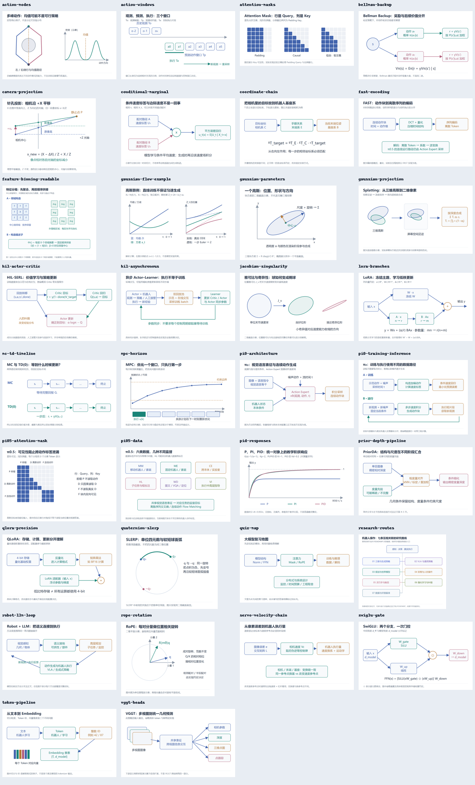
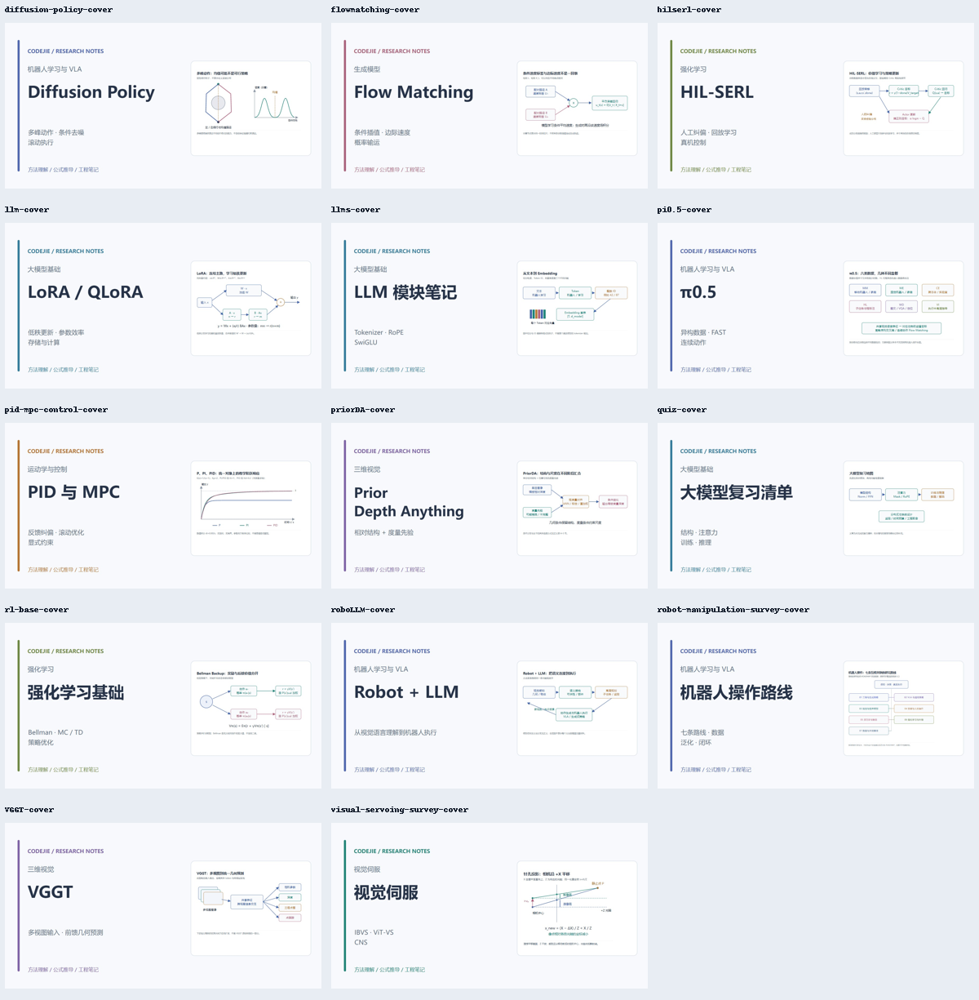
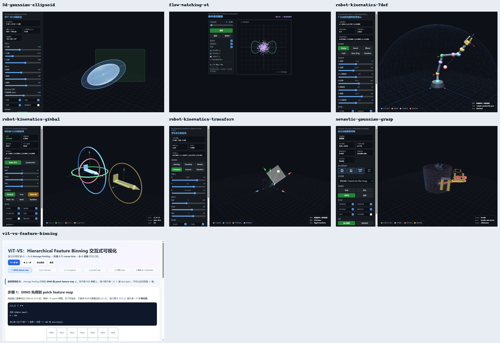
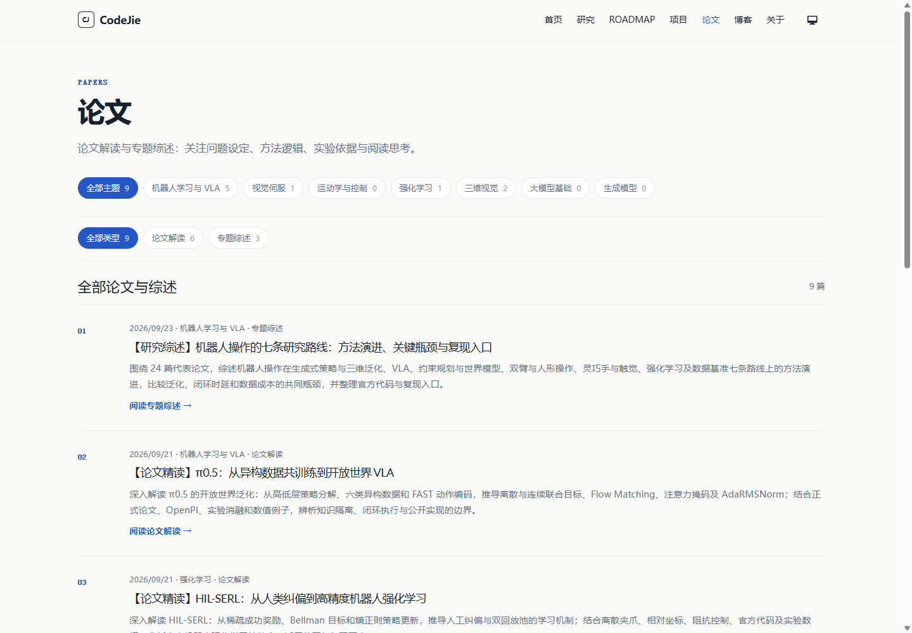
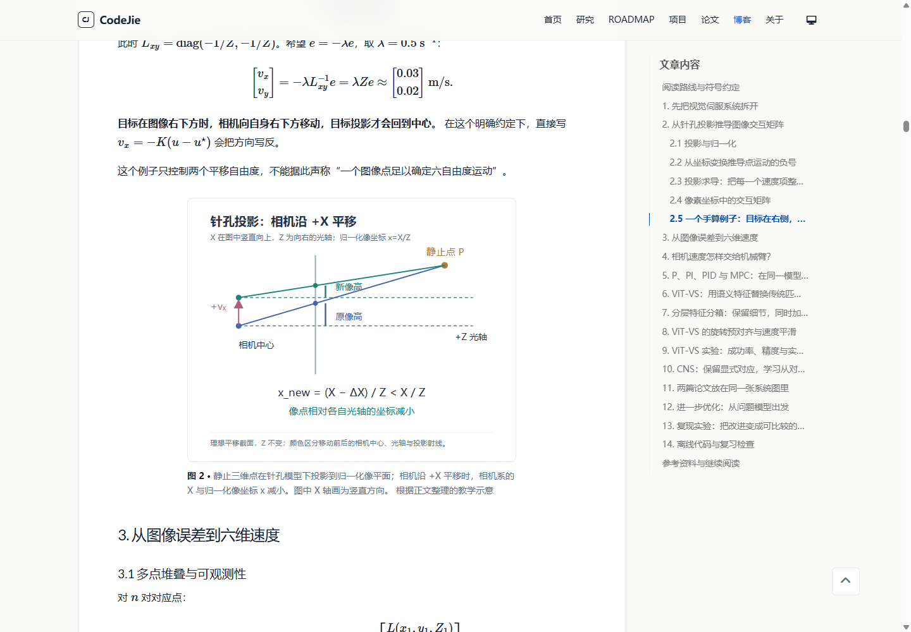
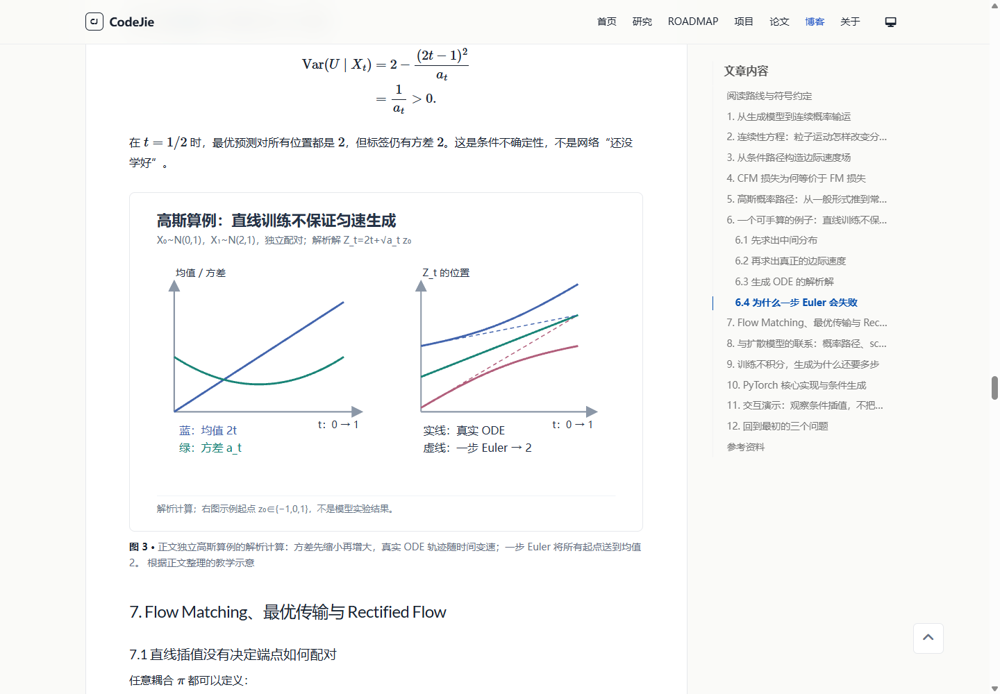

# 博客分类与插图整理验收记录

交付基线：18 篇文章；七个主分类；四种内容类型。文章原地址保持可用，原始图片全部保留。

## 分类与页面

| 分类 | 篇数 |
|---|---:|
| 机器人学习与 VLA | 5 |
| 视觉伺服 | 1 |
| 运动学与控制 | 2 |
| 强化学习 | 2 |
| 三维视觉 | 3 |
| 大模型基础 | 4 |
| 生成模型 | 1 |

博客展示全部 18 篇，支持主题与类型组合筛选；论文页展示 6 篇论文解读和 3 篇专题综述。旧 VLA、控制、多模态模型归档保留访问入口；世界模型筛选导向路线图。

| 文章 | 主分类 | 内容类型 | 新教学图 |
|---|---|---|---:|
| [【LLMs】LoRA 与 QLoRA 学习笔记：从矩阵形状到一次参数更新](../_posts/2025-09-11-llm.md) | 大模型基础 | 基础教程 | 2 |
| [【Transformer】Attention Is All You Need：从注意力机制到手写实现](../_posts/2025-11-26-transformer.md) | 大模型基础 | 基础教程 | 1 |
| [【LLMs】学习笔记：Tokenizer、注意力缩放、RoPE 与 SwiGLU](../_posts/2025-12-03-llms.md) | 大模型基础 | 基础教程 | 3 |
| [【LLMs】大模型面试题](../_posts/2025-12-08-quiz.md) | 大模型基础 | 问答清单 | 0 |
| [【Robot+LLM】Robot+LLM 研究方向调研综述](../_posts/2025-12-14-roboLLM.md) | 机器人学习与 VLA | 专题综述 | 1 |
| [【深度估计】Prior Depth Anything：用任意度量先验对齐单目深度](../_posts/2026-03-26-priorDA.md) | 三维视觉 | 论文解读 | 1 |
| [【3D 视觉】3D Gaussian Splatting：表示、渲染与落地场景](../_posts/2026-04-01-3DGSS.md) | 三维视觉 | 基础教程 | 2 |
| [【生成模型】Flow Matching：从连续性方程到条件流匹配的原理与推导](../_posts/2026-04-01-flowmatching.md) | 生成模型 | 基础教程 | 2 |
| [【3D 视觉】VGGT：Visual Geometry Grounded Transformer 速览](../_posts/2026-04-01-VGGT.md) | 三维视觉 | 论文解读 | 1 |
| [【机器人】π₀：Physical Intelligence 的 VLA 流式动作基础模型](../_posts/2026-04-02-pi0.md) | 机器人学习与 VLA | 论文解读 | 2 |
| [【机器人运动学】从坐标变换、四元数到七自由度机械臂的正逆运动学](../_posts/2026-04-17-robot-kinematics.md) | 运动学与控制 | 基础教程 | 3 |
| [【控制器】从 P、PI、PID 到 MPC：原理、公式推导与工程实践](../_posts/2026-09-18-pid-mpc-control.md) | 运动学与控制 | 基础教程 | 2 |
| [【机器人学习】Diffusion Policy：从条件去噪到闭环动作生成的原理与推导](../_posts/2026-09-19-diffusion-policy.md) | 机器人学习与 VLA | 论文解读 | 2 |
| [【强化学习】从 Bellman 方程到 Actor–Critic：原理、推导与算法主线](../_posts/2026-09-19-rl-base.md) | 强化学习 | 基础教程 | 2 |
| [【论文调研】视觉伺服：从 IBVS 推导到 ViT-VS 与 CNS](../_posts/2026-09-19-visual-servoing-survey.md) | 视觉伺服 | 专题综述 | 2 |
| [【论文精读】HIL-SERL：从人类纠偏到高精度机器人强化学习](../_posts/2026-09-21-hilserl.md) | 强化学习 | 论文解读 | 2 |
| [【论文精读】π0.5：从异构数据共训练到开放世界 VLA](../_posts/2026-09-21-pi0.5.md) | 机器人学习与 VLA | 论文解读 | 3 |
| [【研究综述】机器人操作的七条研究路线：方法演进、关键瓶颈与复现入口](../_posts/2026-09-23-robot-manipulation-survey.md) | 机器人学习与 VLA | 专题综述 | 1 |

## 教学图与布局

32 张新增教学图均为可编辑 SVG。另有分箱原图的一张可读重绘和仅用于封面的复习地图；这两张不计入 32 张新增教学图。正文合计 48 处静态图、16 个 Mermaid 逻辑图及 7 处交互演示。

正文最大 740px；小图最大 320px，中图最大 520px。原论文低分辨率图不放大到超过其原始宽度。图注与替代文本分开，使用语义化 figure/figcaption，沿用 Chirpy 图片放大。

| 文章 | 章节 | 图源 | 布局 |
|---|---|---|---|
| llm | 2. 节后 | [lora-branches](../assets/images/figures/lora-branches.svg) | 全宽 |
| llm | 7. 节后 | [qlora-precision](../assets/images/figures/qlora-precision.svg) | 全宽 |
| transformer | 9. 节后 | [attention-masks](../assets/images/figures/attention-masks.svg) | 全宽 |
| llms | 2. 节后 | [token-pipeline](../assets/images/figures/token-pipeline.svg) | 全宽 |
| llms | 5. 节后 | [rope-rotation](../assets/images/figures/rope-rotation.svg) | 中图 |
| llms | 6. 节后 | [swiglu-gate](../assets/images/figures/swiglu-gate.svg) | 全宽 |
| roboLLM | 1. 节后 | [robot-llm-loop](../assets/images/figures/robot-llm-loop.svg) | 全宽 |
| priorDA | 2. 节后 | [prior-depth-pipeline](../assets/images/figures/prior-depth-pipeline.svg) | 全宽 |
| 3DGSS | 2. 节后 | [gaussian-parameters](../assets/images/figures/gaussian-parameters.svg) | 中图 |
| 3DGSS | 3. 节后 | [gaussian-projection](../assets/images/figures/gaussian-projection.svg) | 全宽 |
| flowmatching | 3. 节后 | [conditional-marginal](../assets/images/figures/conditional-marginal.svg) | 全宽 |
| flowmatching | 6. 节后 | [gaussian-flow-example](../assets/images/figures/gaussian-flow-example.svg) | 全宽 |
| VGGT | 2. 节后 | [vggt-heads](../assets/images/figures/vggt-heads.svg) | 全宽 |
| pi0 | 4. 节后 | [pi0-architecture](../assets/images/figures/pi0-architecture.svg) | 全宽 |
| pi0 | 5. 节后 | [pi0-training-inference](../assets/images/figures/pi0-training-inference.svg) | 全宽 |
| robot-kinematics | 2.6 节后 | [coordinate-chain](../assets/images/figures/coordinate-chain.svg) | 全宽 |
| robot-kinematics | 4.5 节后 | [quaternion-slerp](../assets/images/figures/quaternion-slerp.svg) | 中图 |
| robot-kinematics | 6.3 节后 | [jacobian-singularity](../assets/images/figures/jacobian-singularity.svg) | 全宽 |
| pid-mpc-control | 4. 节后 | [pid-responses](../assets/images/figures/pid-responses.svg) | 全宽 |
| pid-mpc-control | 7. 节后 | [mpc-horizon](../assets/images/figures/mpc-horizon.svg) | 全宽 |
| diffusion-policy | 6. 节后 | [action-modes](../assets/images/figures/action-modes.svg) | 全宽 |
| diffusion-policy | 8. 节后 | [action-windows](../assets/images/figures/action-windows.svg) | 全宽 |
| rl-base | 2. 节后 | [bellman-backup](../assets/images/figures/bellman-backup.svg) | 全宽 |
| rl-base | 6. 节后 | [mc-td-timeline](../assets/images/figures/mc-td-timeline.svg) | 全宽 |
| visual-servoing-survey | 2. 节后 | [camera-projection](../assets/images/figures/camera-projection.svg) | 中图 |
| visual-servoing-survey | 4. 节后 | [servo-velocity-chain](../assets/images/figures/servo-velocity-chain.svg) | 全宽 |
| hilserl | 6. 节后 | [hil-actor-critic](../assets/images/figures/hil-actor-critic.svg) | 全宽 |
| hilserl | 8. 节后 | [hil-asynchronous](../assets/images/figures/hil-asynchronous.svg) | 全宽 |
| pi0.5 | 3. 节后 | [pi05-data](../assets/images/figures/pi05-data.svg) | 全宽 |
| pi0.5 | 5. 节后 | [fast-encoding](../assets/images/figures/fast-encoding.svg) | 全宽 |
| pi0.5 | 7. 节后 | [pi05-attention-mask](../assets/images/figures/pi05-attention-mask.svg) | 全宽 |
| robot-manipulation-survey | 第 1. 节前 | [research-routes](../assets/images/figures/research-routes.svg) | 全宽 |

### 原有图片纠正

- Transformer 三张论文图采用 513、279、269px 的原始宽度上限；原论文架构图先出现，简化 Mermaid 位于折叠补充区。
- ViT-VS 流程图解释控制、匹配与预对齐三个部分；分箱原图保留在折叠存档，可读版本分成邻域构造与描述子拼接两部分。
- EMA 图明确位置误差与路径长度比两个坐标轴；受扰动图解释为特征对应示例。
- 完整 Table I 放在文字结果表后的折叠核对区，保留单位与文献结果标记。
- convergence 图更正为六维速度随迭代变化，final-error 图更正为位姿误差随迭代变化。
- runtime 图更正为帧率 Hz；industrial-setup 图更正为原论文图 7(d) 的三维末端轨迹。
- CNS 比较图保留方法设计动机的条件说明。手写 A1/A2 默认折叠，展开才插入压缩预览，原图由放大入口按需访问。

## 封面、预览与资源

新增 14 张 1200×630 专属封面，同时保存 SVG 图源和 JPEG 展示版本；原有四张专属封面保留。项目卡片及手机演示预览均使用实际界面截图。

桌面在演示接近可视区域时挂载 iframe，并预留与实时窗口相同的高度；手机初始不挂载 iframe，使用预览与独立打开入口。运动学三处演示移到坐标变换、万向锁和正运动学章节，其他移动位置保留了原章节索引。

资源压缩统计：

- 视觉伺服 12 张原图合计 14.59 MiB；压缩预览合计 1.01 MiB。
- 最大压缩预览 175 KiB，原图保留。

## 验证结果

- Jekyll 生产构建通过；主题固定为 7.3.1，锁文件包含 Windows 与 Linux 平台。
- `python tools/check-content.py --baseline --site .qa/site` 通过：分类、类型、媒体数量、图源、图注、尺寸、重复 ID、嵌套链接及两篇用户原有正文保留检查。
- HTMLProofer 通过：124 个 HTML 文件、944 个内部链接及内部锚点。Windows 使用项目内 DLL 引导工具加载本机 Git 提供的 libcurl。
- Chrome 页面验收 483 项通过，素材验收 41 项通过，Mermaid 可读字号及局部滚动检查 96 项通过；页面 JavaScript 异常为 0。
- 全部 18 篇文章在 375px、1440px 下逐页及逐图检查，另覆盖 768px 深色布局；检查实际图片解码、Mermaid SVG、放大与 Esc 关闭、组合筛选与历史记录、折叠存档及演示挂载。
- 无 JavaScript 时博客仍可阅读全部文章。

以上为本机生产构建和 Chrome 验证记录；GitHub Actions 已加入内容检查，本轮未触发远程部署。外部文献链接沿用文章原来源，本轮链接检查关闭外部网络验证。

### 页面预览

## 后续维护

- 分类与类型：`_data/domains.yml`、`_data/content_types.yml`。
- 新图位置清单：`_data/illustrations.yml`；图源与确定性生成脚本：`assets/images/figures/`、`tools/build-illustrations.py`。
- 共用组件：`_includes/figure.html`、`_includes/demo-frame.html`、`_includes/note-list.html`。
- 日常新增文章运行普通内容检查；`--baseline` 用于本次 18 篇交付快照，CI 的普通检查允许继续发布新文章。
- 浏览器验收工具只使用独立的项目缓存配置目录；日志与完整截图在 `.qa/browser/`。
