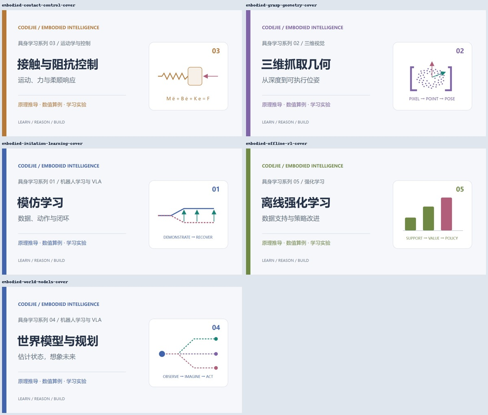
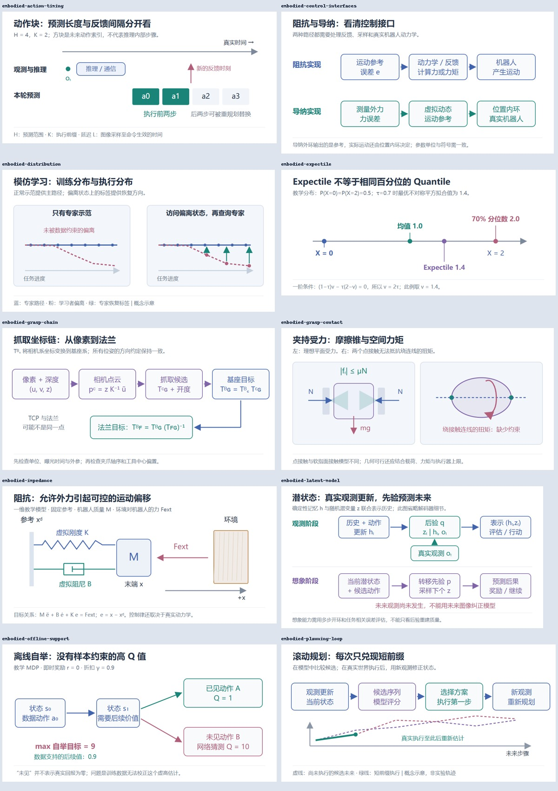
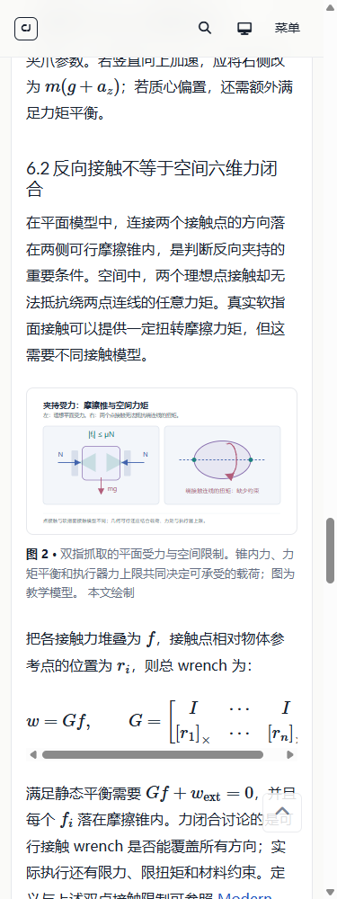

# 具身智能学习系列交付记录

日期：2026-10-24。基于现有博客分类新增学习教程，没有使用 skill。

## 阅读顺序与内容范围

五篇均为 `content_type: tutorial`，各有先修说明、推导、完整可运行的 Python 算例、实验设计、四道带答案的复习题及一手参考资料。

| 顺序 | 文章 | 主分类 | 学习重点 |
| --- | --- | --- | --- |
| 01 | [模仿学习：从行为克隆、分布偏移到可复现的机器人闭环](../_posts/2026-10-24-embodied-imitation-learning.md) | 机器人学习与 VLA | 状态分布、误差累积、DAgger、动作语义、时序对齐、动作块、评估 |
| 02 | [三维抓取几何：从一张深度图到可执行的抓取位姿](../_posts/2026-10-24-embodied-grasp-geometry.md) | 三维视觉 | 反投影、外参、TCP、协方差传播、摩擦锥、力闭合、轨迹可行性 |
| 03 | [接触与阻抗控制：从弹簧阻尼模型到机器人柔顺操作](../_posts/2026-10-24-embodied-contact-control.md) | 运动学与控制 | 阻抗与导纳、接触平衡、功率、混合控制、被动性、采样 |
| 04 | [世界模型与规划：从部分可观测状态到潜空间中的行动选择](../_posts/2026-10-24-embodied-world-models.md) | 机器人学习与 VLA | 信念更新、潜状态、变分目标、CEM-MPC、误差传播、不确定性、想象策略 |
| 05 | [离线强化学习：从分布外价值误差到 CQL 与 IQL](../_posts/2026-10-24-embodied-offline-rl.md) | 强化学习 | 价值外推、CQL 梯度、expectile、优势加权、轨迹拼接、奖励与终止 |

正文含约 1.63 万汉字，另有公式、代码、表格、图注与参考资料。主题名称沿用现有七类，世界模型继续作为标签和研究方向；没有另建主分类。

每篇顶部的可展开阅读路线来自 [_data/embodied_series.yml](../_data/embodied_series.yml)，由 [系列组件](../_includes/embodied-series.html) 生成；文章之间、与已有基础教程之间均建立站内链接。

## 原创示意图与封面

新增 10 张可编辑 SVG 教学图和 5 张 1200×630 的封面。封面同时保留 SVG 图源与 JPEG 展示版本，JPEG 约 56—64 KiB。正文沿用统一 `figure.html` 组件，具备图注、替代文本、固定宽高和放大查看入口。

| 文章 | 图 1 | 图 2 |
| --- | --- | --- |
| 模仿学习 | [状态分布与恢复数据](../assets/images/figures/embodied-distribution.svg) | [动作时间轴](../assets/images/figures/embodied-action-timing.svg) |
| 三维抓取 | [抓取坐标链](../assets/images/figures/embodied-grasp-chain.svg) | [接触力与空间力矩](../assets/images/figures/embodied-grasp-contact.svg) |
| 接触控制 | [阻抗模型](../assets/images/figures/embodied-impedance.svg) | [阻抗与导纳接口](../assets/images/figures/embodied-control-interfaces.svg) |
| 世界模型 | [观测与想象阶段](../assets/images/figures/embodied-latent-model.svg) | [滚动规划](../assets/images/figures/embodied-planning-loop.svg) |
| 离线 RL | [价值外推与自举](../assets/images/figures/embodied-offline-support.svg) | [Expectile 算例](../assets/images/figures/embodied-expectile.svg) |

图源由 [build-embodied-figures.py](../tools/build-embodied-figures.py) 可重复生成。图中轨迹、参数与数值分别标注为概念示意或教学模型；没有新增真实机器人实验成绩。





## 算例验证

[check-embodied-examples.py](../tools/check-embodied-examples.py) 直接提取并执行五篇文章中的 Python 代码块，避免复制一份代码后与正文失去同步。依赖 NumPy；这些算例不调用真实机器人。

| 算例 | 实际检查结果 |
| --- | --- |
| 模仿学习恢复 | 正常示范模型的横向误差仍为 0.2；加入恢复标签后，20 步误差约为 1.907×10⁻⁷ |
| 反投影与坐标链 | 相机点 `[0.06, 0.03, 0.6]` 转换为基座点 `[0.37, 0.16, 0.8]`，逆变换一致 |
| 接触控制 | 两种刚度下接触力终值分别为 1.818 N 与 5.714 N，与解析平衡解一致 |
| CEM-MPC | 固定随机种子 7，20 步后位置约为 1.001，目标为 1 |
| Expectile 与加权策略 | 0.7-expectile 为 1.4，加权动作概率约为 `[0.1192, 0.8808]` |

另独立核对深度误差传播的标准差 `[1.118, 1.031, 5] mm`，以及 16/20 成功率对应的 Wilson 区间约 58.4%—91.9%。这些数字都属于正文明确设定的算例。

## 页面与构建验证

- `bundle exec jekyll build --destination .qa/site`：通过。
- `python tools/check-content.py --site .qa/site`：通过；当前 23 篇，七类数量依次为 **7、1、3、3、4、4、1**。
- 类型数量：基础教程 13、论文解读 6、专题综述 3、问答清单 1；论文页仍为 9 篇。
- 全站教学图清单 42 项、正文图片放置 58 处；原有 16 个 Mermaid 与 7 处演示保留。
- HTMLProofer 本地链接检查：152 个 HTML 文件，1076 条内部链接，32 个文件中的锚点检查通过。
- 新系列资源检查：25 项通过，核对 SVG 实际加载、文本在画布内，并渲染封面。
- 新系列浏览器检查：277 项通过。五篇 × 375/768/1440px × 明/暗主题，核对内容、MathJax、图注、图片、组合筛选和系列导航；图片放大与 Escape 关闭通过。
- 整站浏览器回归：578 项通过，覆盖更新后的 23 篇文章、分类筛选、浏览器前进后退、旧分类入口、无 JavaScript 阅读、原有演示和附录。
- `git diff --check`：通过。

已修复本轮检查中发现的两处问题：Windows 默认预览服务把 SVG 误报为 `image/svg`，以及抓取矩阵换行紧接方括号导致的 LaTeX 解析错误。预览服务现在通过 [preview-server.py](../tools/preview-server.py) 明确指定 SVG MIME；浏览器检查也要求 SVG 内容实际存在，避免空白截图被误判为成功。



## 复查与继续维护

```powershell
python tools/check-embodied-examples.py
python tools/check-content.py --site .qa/site
python tools/preview-server.py --directory .qa/site --port 4174
```

在另一个终端：

```powershell
node tools/browser-audit.mjs series http://127.0.0.1:4174
```

当前本地预览入口为 <http://127.0.0.1:4174/blog/>。全文参考资料已经链接至论文、作者官方代码或教材页面，方法说明与自行推导的教学例子分别说明了适用条件。未执行 Git 提交、推送或线上部署；此前文章与原始图片保留。

上一轮分类与插图整理记录见 [blog-organization.md](blog-organization.md)，其中 18 篇是当时的历史快照。
